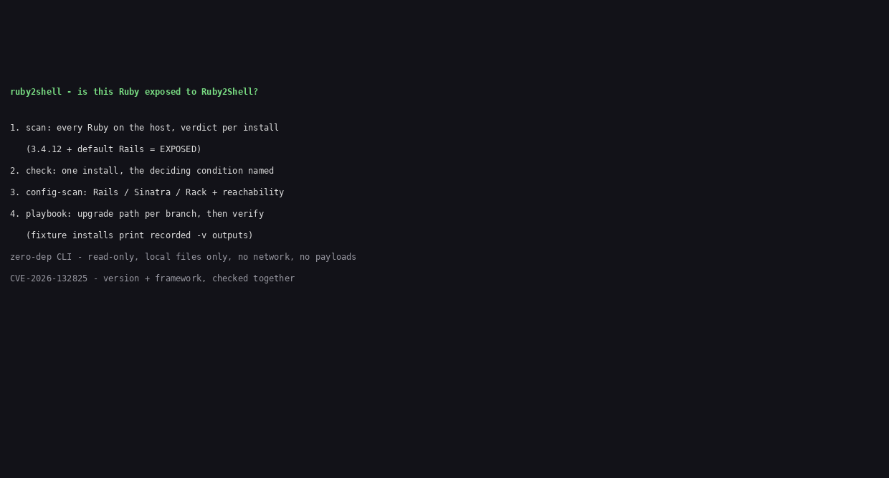

# ruby2shell

Is this Ruby install, or this app, actually exposed to Ruby2Shell? A zero-dependency CLI that decides from the three live conditions together: Ruby version vs the 18/11/2026 fixed builds, framework exposure, and sharp-s input reachability from config evidence.

For operators patching Ruby on the day the fix lands: one command per host, with a CI gate and a first-hour playbook.



## Why

Ruby2Shell (CVE-2026-132825 / GHSA-34m4-m9fh-gqp5) is a one-byte heap buffer overflow in Ruby's string case conversion, disclosed 18/11/2026 by Veria Labs. Most single-byte encodings have no capital sharp s: upcasing it writes two bytes (`SS`) but the loop only bounds-checks one. The output buffer is the input length plus 20 bytes, so an input with 21 sharp-s characters overflows the buffer by one byte. The buggy loop has been there since Ruby 2.4.0. It is reachable without authentication on default Rails and classic-style Sinatra; plain Rack is not exposed by default.

The flaw is in the interpreter, not in any gem, so the usual checks miss the point:

- `bundle audit` checks gems against an advisory database. This is a Ruby runtime advisory, so a clean audit on an affected Ruby is a false negative by design.
- A version-only CVE match says "vulnerable" on a plain-Rack app that is not exposed by default, and says nothing about whether the app runs default Rails, classic Sinatra, or a self-hosted product with its own bundled Ruby.

Exposure is decided per install plus per app, by version plus framework plus input reachability together. This tool checks exactly that, locally, with no network and no payload.

## Head-to-head

| Tool | What it checks | What it misses |
|---|---|---|
| **ruby2shell** (this tool) | Ruby version per branch, framework exposure from Gemfile.lock / config.ru / Dockerfile, sharp-s reachability evidence, self-hosted product versions, fleet scan, CI gate, playbook | Only CVE-2026-132825 drives verdicts; the other six 18/11/2026 flaws are a checklist note |
| Mahgal/ruby2shell-check (Python, single file) | Ruby version, framework reachability, product versions, --json, --demo | Single script, no package; checks one version string at a time; no fleet scan, no playbook, no explain, no init |
| Semgrep detection-scripts (bash / PowerShell) | Version from a running process's own libruby, backport-aware, MethodOverride / Rodauth reachability, fleet wrappers (ssh / ansible / k8s) | Detection scripts, not an installable tool; decides per running process only (installed-but-not-running interpreters are "not counted"); no Gemfile.lock parsing, no product check, no playbook |
| Trivy / Grype | Installed package / image versions vs a CVE database | Version matching only; no framework or reachability condition, no per-app view |
| bundler-audit | Gemfile.lock gems vs ruby-advisory-db | Checks gems, not the interpreter; cannot see this flaw at all |
| Vendor advisories + `ruby -v` by hand | The authoritative fix list | Manual per host, no fleet view, no framework check, no gate |

**Where rivals beat us, honestly:** Mahgal's checker is a single Python file: clone and run, no build step, 0.062 s median runtime, and it shipped hours before this tool. Semgrep's detectors read the version from a running process's own libruby without executing anything and cover all seven advisories with fleet wrappers; ruby2shell v0.1.0 verdicts only on CVE-2026-132825 and scans installed Rubies on disk. Trivy/Grype cover the whole dependency tree and every CVE at once. ruby2shell never proves exploitability - it proves exposure conditions, and says so on every output.

## Quickstart

Install from source (npm publish is pending an owner decision on the token - there is no `ruby2shell` package on npm yet):

```sh
git clone https://github.com/techdevfun/ruby2shell.git
cd ruby2shell
npm install
npm run build
node dist/cli.js scan --app ./my-rails-app
```

Node 20+ required. Zero runtime dependencies.

```sh
# One install, one app: is it exposed?
ruby2shell check /usr/local/ruby-3.4.12 --app ./my-rails-app

# A version string, no install needed:
ruby2shell check 3.4.12 --app ./my-rails-app

# A self-hosted product version:
ruby2shell check --product gitlab --product-version 19.6.0

# App config only (no Ruby version needed):
ruby2shell config-scan ./my-rails-app

# First-hour stopgap:
ruby2shell playbook
```

## Demo

The GIF below is a real transcript (see `demo/transcript.txt`): scan a seeded fixture fleet, check the vulnerable install, config-scan the Rails app, read the playbook, then check the fixed install. The demo GIF is 588 frames, 29.4 s. Fixture installs print recorded `-v` outputs from `examples/`; the 3.4.12 text is recorded from a real Ruby 3.4.12 built from source on 20/11/2026, the rest are representative format with version numbers from the advisory.


## Commands

| Command | What it does | Exit codes |
|---|---|---|
| `scan [--dirs <dir>...] [--app <dir>] [--no-system] [--json]` | Discover Ruby installs (PATH, rbenv, rvm, system dirs, --dirs) and verdict each one | 0 no EXPOSED, 1 >=1 EXPOSED, 2 no Ruby found / usage error |
| `check <ruby-dir-or-version> [--app <dir>] [--json]` | Verdict a single install, binary, or bare version string | 0 SAFE, 1 EXPOSED or AT-RISK, 2 UNKNOWN / usage error |
| `check --product <name> --product-version <ver> [--json]` | Verdict a self-hosted product version (gitlab, ghes, chatwoot, mastodon, openproject, discourse) | Same as check |
| `config-scan <app-dir> [--json]` | Parse Gemfile.lock, config.ru, Dockerfile, .ruby-version; list case-conversion calls on request params | 0 not exposed by default, 1 exposed framework found, 2 no app evidence / usage error |
| `playbook [--json]` | First-hour stopgap | 0 |
| `explain <topic>` | Background: CVE-2026-132825, GHSA-34m4-m9fh-gqp5, EXPOSED, AT-RISK, SAFE, UNKNOWN, rails, sinatra, rack, versions, products, siblings | 0, or 2 for an unknown topic |
| `init` | Write `ruby2shell.config.json` | 0 |

`--no-system` scans only the `--dirs` given (skips PATH, rbenv, rvm and system dirs) - useful when a fleet scan must be deterministic.

## Verdict rules

Exposure needs the version AND the framework condition together:

- **EXPOSED**: Ruby in the affected range AND default Rails or classic Sinatra (or an explicit `Rack::MethodOverride` in the middleware evidence), or an affected self-hosted product version.
- **SAFE**: fixed Ruby (>= 3.3.14 / 3.4.13 / 4.0.10), or a Ruby before 2.4.0 (predates the flaw), or an affected Ruby on plain Rack / another framework with no case-conversion evidence ("not exposed by default"), or a patched product release.
- **AT-RISK**: affected Ruby but framework unknown, or Rails `api_only` (MethodOverride may be absent), or an affected Ruby whose own code case-converts request params, or an EOL line (3.2 and earlier) with no fix.
- **UNKNOWN**: version unparseable, distro build (backport unconfirmed), non-CRuby engine (JRuby / TruffleRuby), Ruby line not in the 18/11/2026 fixed-build table, or product version not covered by the vendor table.

Fixed builds (checked 20/11/2026): Ruby 4.0.10, 3.4.13, 3.3.14. Affected: 4.0.0-4.0.9, 3.4.0-3.4.12, 3.3.13 and earlier (back to 2.4.0). Ruby 3.2 and earlier are end of life with no fix. The branch trap: 3.4.13 is fixed but 3.3.13 is still vulnerable - this tool compares against explicit per-branch ranges, never a plain numeric threshold.

Self-hosted products (Veria Labs status table, updated 20/11/2026 11:58 UTC): GitLab fixed in 19.6.1 / 19.5.8 / 19.4.10; Mastodon fixed in 4.7.6 / 4.6.12 / 4.5.22 / 4.4.29; OpenProject fixed in 17.9.8 / 17.8.3; Discourse base image fixed in 2.0.20261119-0203; Chatwoot fixed in 4.20.1. GitHub Enterprise Server (3.22.5 and earlier) still had no fixed release yet on 20/11/2026.

Scores, both of them: Ruby rates the flaw Critical and publishes no CVSS of its own; MITRE CNA CVSS 3.1 is 7.4 High (vector CVSS:3.1/AV:L/AC:H/PR:N/UI:N/S:U/C:H/I:H/A:H). NVD assessment was not yet provided on 20/11/2026.

## CI flow

```sh
ruby2shell scan --app ./my-rails-app --json
```

Gate on exit code: 0 passes, 1 fails the build (an install is EXPOSED or AT-RISK), 2 fails the build (UNKNOWN - investigate, do not assume safe). `--json` output carries the same data plus per-install evidence (paths, raw `ruby -v` text) for the audit trail.

## Honest limits

- This tool proves exposure conditions, not exploitability. It never sends a payload and never proves an app is exploitable. The only command it ever runs against a Ruby is `ruby -v`.
- It checks exactly one CVE (CVE-2026-132825). The other six flaws from the same 18/11/2026 release are listed by `explain siblings` as a checklist, not as verdicts.
- Framework detection reads config files, not a running process: if the Gemfile.lock or config.ru on disk is not the one serving traffic, the verdict follows the wrong app. The evidence paths are printed in every output.
- Distro Ruby builds (e.g. `3.3.0-1ubuntu`) are UNKNOWN: the distro may have backported the fix. Confirm in the distro advisory.
- Vendor product versions are pinned to the Veria Labs status table of 20/11/2026 (re-checked 12:05 UTC). Chatwoot fixed in 4.20.1; GitHub Enterprise Server still had no fix yet then; check the vendor before assuming a newer release is patched.
- No exploitation in the wild was reported as of 20/11/2026, and the CVE was not in the CISA KEV catalog as of the 2026-11-18 catalog version. Veria Labs publishes a proof of concept demonstrating RCE on stock Rails on 25/11/2026 (or later if major vendors have not shipped a fix). Patch before then.
- Name neighbours: `Mahgal/ruby2shell-check` is a same-concept Python checker (shipped 20/11/2026, hours before this tool); `scadastrangelove/ruby2shell` ships Suricata / ModSecurity rules for the same CVE; `evenomn/CVE-2026-132825` is a PoC repository. Different owners, different products - this repo is the installable TypeScript CLI.

## Roadmap

- `--product` coverage for more self-hosted Ruby products as vendors publish fixes.
- Distro backport detection (read the package changelog, like the Semgrep detectors do).
- Running-process scan: match running Rubies to installed ones, so an idle Ruby on disk is not confused with the one serving traffic.
- Publish to npm (`ruby2shell`) once the owner approves the token.

## License

MIT. See [LICENSE](LICENSE).
